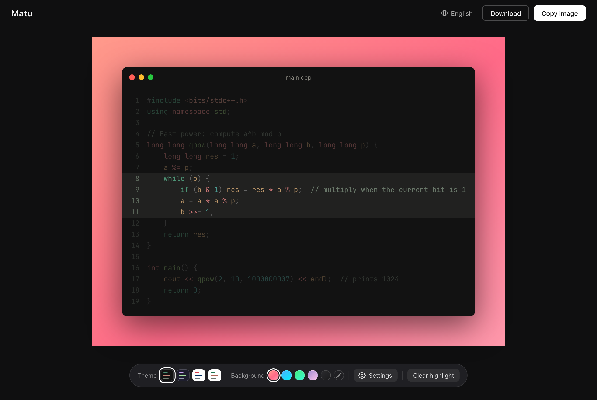

English | [简体中文](README.zh-CN.md)

# Matu

Turn code into a beautiful image — copy it in one click and share it anywhere.



**Live demo: <https://JohnSmitho91p8.github.io/matu/>**

## Features

- **Edit in place** — type or paste code right on the card; what you see is what you export
- **Syntax highlighting** powered by [Shiki](https://shiki.style), the same engine as VS Code. C++ is supported today; more languages are coming
- **4 code themes** (2 dark, 2 light) and **5 gradient backgrounds**, or no background at all
- **3 padding sizes** and a line-number toggle
- **Good CJK support** — JetBrains Mono for code, LXGW WenKai Mono for Chinese and Japanese comments and D2Coding for Korean, all self-hosted and aligned to the same character grid
- **One-click copy** to the clipboard (2× resolution), or download as PNG
- **Multilingual interface** — English, 简体中文, 日本語 and 한국어 (picked from your browser language, switchable any time)
- **Remembers your settings and code** in the browser's local storage
- Runs entirely in the browser; nothing is uploaded

## Keyboard shortcuts

| Shortcut | Action |
|---|---|
| `Cmd/Ctrl + Shift + C` | Copy image |
| `Cmd/Ctrl + S` | Download image |

## Run locally

Requires Node.js 20.19+ (or 22.12+).

```bash
npm install
npm run dev      # then open http://localhost:5173/matu/
npm run build    # production build in dist/
npm run preview  # preview the production build
```

## Tech stack

Vite · Vue 3 · Shiki · modern-screenshot

## License

[MIT](LICENSE)
