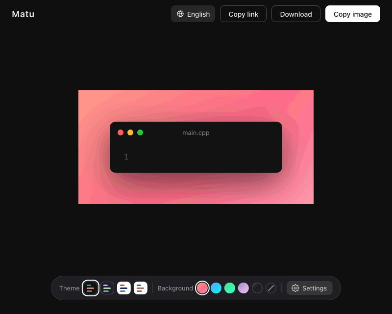

English | [简体中文](README.zh-CN.md)

# Matu

Turn code into a beautiful image — copy it in one click and share it anywhere.




**Live demo: <https://JohnSmitho91p8.github.io/matu/>**

## Features

- **Edit in place** — type or paste code right on the card; what you see is what you export
- **Syntax highlighting** powered by [Shiki](https://shiki.style), the same engine as VS Code. Supports **C++, C, Python, Java and JavaScript**, with automatic language detection (or pick one manually)
- **Line highlighting** — click a line number to spotlight it, Shift-click to select a range; every other line fades out. Perfect for pointing at the important part
- **Wrong and right marks** — keep clicking a line number to mark the line as wrong (red) or right (green), handy for explaining a fix; line numbers can also start from any number
- **4 code themes** with live previews, **5 gradient backgrounds** or no background at all, **3 padding sizes**, **3 font sizes** and a line-number toggle
- **Share as a link** — copy a link that holds your code and look; whoever opens it sees the same card and can copy the original code. The code lives only in the part of the address after `#`, which browsers never send to a server, so nothing is uploaded
- **Optional signature** — add your handle (for example `@yourname`) to the corner of the image
- **Good CJK support** — JetBrains Mono for code, LXGW WenKai Mono for Chinese and Japanese comments and D2Coding for Korean, all self-hosted and aligned to the same character grid
- **One-click copy** to the clipboard (2× resolution), or download as PNG
- **Near-instant copy, download and share** — the image is prepared in the background while you edit, so it's ready the moment you click
- **A clean toolbar** — the theme and background you change most stay on the bar, and everything else lives in a Settings panel
- **Works great on iPhone** — a touch-friendly layout with a bottom toolbar, and a Share button that opens the system share sheet (save to Photos, send to a chat, AirDrop). If sharing isn't available, long-press the preview image to save it
- **Multilingual interface** — English, 简体中文, 日本語 and 한국어 (picked from your browser language, switchable any time)
- **Install it and use it offline** — add Matu to your computer or phone, and after the first visit it works without a network, even when github.io can't be reached
- **Remembers your settings and code** in the browser's local storage
- Runs entirely in the browser; nothing is uploaded

## Keyboard shortcuts

| Shortcut | Action |
|---|---|
| `Cmd/Ctrl + Shift + C` | Copy image |
| `Cmd/Ctrl + Shift + L` | Copy link |
| `Cmd/Ctrl + S` | Download image |

## Install on your computer or phone

Matu can be installed as an app. After you have opened it once, it also works offline: editing, switching themes and languages, marking lines, exporting, copying, and opening share links.

- **Computer (Chrome or Edge)**: click the install icon at the right end of the address bar, or open the browser menu and choose *Install Matu*. It opens in its own window.
- **iPhone (Safari)**: tap the Share button, then *Add to Home Screen*.

New versions are downloaded in the background and take effect the next time you open Matu.

Good to know:

- The first visit needs network access to github.io (in mainland China you may need a VPN). Once it has loaded, the app is saved in your browser.
- The offline copy belongs to the browser you opened it in. If you opened Matu in Chrome, only Chrome can open it offline. On iPhone, Safari, the Home Screen app and the WeChat built-in browser each keep their own copy, so open a share link you receive in WeChat with *Open in Safari*.

## Share links

*Copy link* (or `Cmd/Ctrl + Shift + L`) copies an address like `https://…/matu/#s=…` that holds your code, language, file name, theme, background, padding, font size, line numbers, start line and line marks. Your signature and interface language are not included. The data sits after the `#`, so it is never sent to a server. A link can hold roughly 380 lines of code; for longer code, share an image instead.

When you open a link, it replaces the code on your screen, and an *Undo* button on the notice brings your own code back.

## Design principles

1. **Do one thing**: turn code into a good-looking image.
2. **Open and use**: no account, and all your data stays in your browser.
3. **Beautiful by default**: the image looks good without touching a single setting.
4. **Less is more**: a new feature has to be used often enough to earn its place, and features that aren't will be removed.

## Run locally

Requires Node.js 20.19+ (or 22.12+).

```bash
npm install
npm run dev      # then open http://localhost:5173/matu/
npm run build    # production build in dist/
npm run preview  # preview the production build
npm test         # unit tests (Vitest)
npm run test:e2e # end-to-end tests (Playwright; first run: npx playwright install chromium webkit)
```

To try it on a phone on the same Wi-Fi, run `npm run dev -- --host` and open the `Network` address it prints. (Sharing and copying images need HTTPS, so test those on the deployed site.)

## Tech stack

Vite · Vue 3 · Shiki · modern-screenshot

## License

[MIT](LICENSE)
