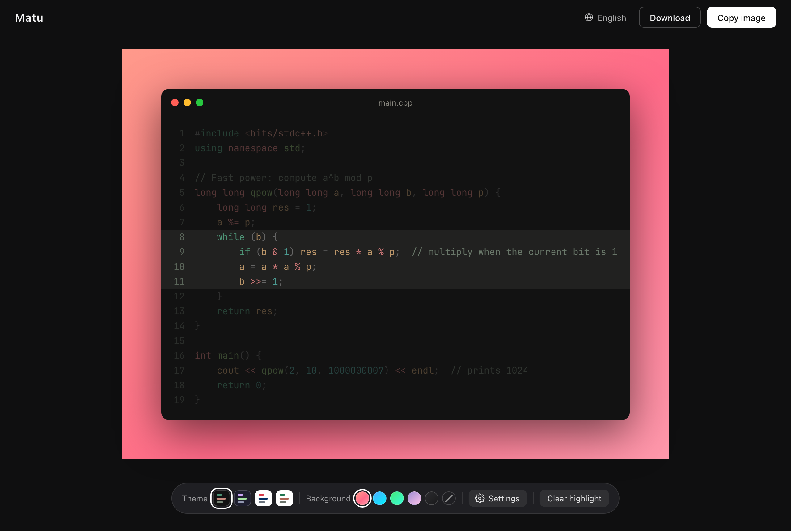
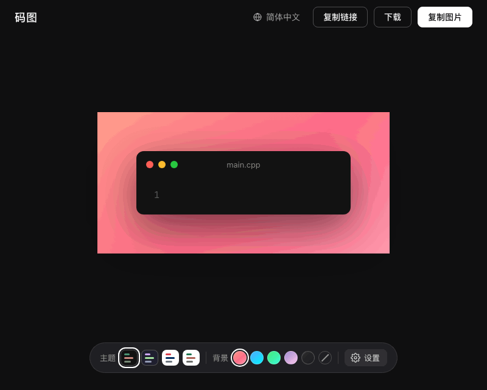

[English](README.md) | 简体中文

# Matu（码图）

把代码变成好看的图片，一键复制，分享给任何人。





**在线使用：<https://JohnSmitho91p8.github.io/matu/>**

## 功能

- **直接在卡片里编辑**：打字或粘贴代码，所见即所得
- **语法高亮**：使用 [Shiki](https://shiki.style)，与 VS Code 同一套高亮引擎。支持 **C++、C、Python、Java、JavaScript**，自动识别语言，也可以手动指定
- **行高亮**：点行号高亮一行，Shift + 点击选中一段，其余行自动变暗，讲重点时很好用
- **对错标记**：连续点行号，可把一行标为错误（红）或正确（绿），讲解改错时很方便；行号也可以从任意数字开始
- **4 个代码主题**（带预览色块）、**5 个渐变背景**（也可以无背景）、**3 档边距**、**3 档字号**，可开关行号
- **分享链接**：复制一个包含代码和外观的链接，对方打开就能看到同样的卡片，还可以复制原代码。代码只存在于网址 `#` 后面的部分，浏览器不会把它发给服务器，所以不会上传
- **可选的署名水印**：在图片角落加上你的名字，比如 `@yourname`
- **中日韩注释显示正常**：代码用 JetBrains Mono，中日文用霞鹜文楷等宽，韩文用 D2Coding，字体均为自托管，并与英文按同一字符网格对齐
- **一键复制图片**到剪贴板（2 倍清晰度），或下载 PNG
- **复制、下载、分享几乎瞬间完成**：编辑时图片就在后台提前生成，点击即得
- **简洁的工具栏**：常用的主题和背景留在工具栏，其余设置收进「设置」面板
- **iPhone 上也好用**：触屏友好的布局和底部工具栏；「分享」按钮会调起系统分享面板（存到相册、发给好友、AirDrop）。如果系统分享不可用，长按预览图片即可保存
- **界面支持英、中、日、韩四种语言**，首次打开按浏览器语言自动选择，也可随时切换
- **可以安装，离线也能用**：把码图安装到电脑或手机上，打开过一次之后，没有网络（或 github.io 打不开）也能正常使用
- **自动记住设置和代码**，保存在浏览器本地
- 完全在浏览器中运行，不会上传任何内容

## 快捷键

| 快捷键 | 作用 |
|---|---|
| `Cmd/Ctrl + Shift + C` | 复制图片 |
| `Cmd/Ctrl + Shift + L` | 复制链接 |
| `Cmd/Ctrl + S` | 下载图片 |

## 安装到电脑或手机

码图可以像应用一样安装。打开过一次之后，没有网络也能使用：编辑、切换主题和语言、标记行、导出、复制，以及打开分享链接。

- **电脑（Chrome 或 Edge）**：点地址栏右侧的安装图标，或打开浏览器菜单选择「安装码图」，会在独立窗口里打开。
- **iPhone（Safari）**：点「分享」按钮，选择「添加到主屏幕」。

新版本会在后台下载，下次打开时自动换上。

需要注意：

- 第一次必须能打开 github.io（在国内需要开 VPN），加载完成后，应用就保存在你的浏览器里了。
- 离线缓存是**跟着浏览器走**的：在 Chrome 里打开过，就只有 Chrome 能离线打开。iPhone 上的 Safari、主屏幕应用、微信内置浏览器的缓存互不相通，所以在微信里收到的分享链接，最好用「在 Safari 中打开」。

## 分享链接

点「复制链接」（或按 `Cmd/Ctrl + Shift + L`），会复制一个形如 `https://…/matu/#s=…` 的链接，里面包含代码、语言、文件名、主题、背景、边距、字号、行号、起始行号和行标记；署名和界面语言不会带上。数据放在 `#` 后面，不会发给任何服务器。一个链接大约能放 380 行代码，更长的请改用图片分享。

打开别人的链接时，会替换你屏幕上的代码；提示里的「撤销」按钮可以找回你自己的代码。

## 设计原则

1. **只做一件事**：把代码变成好看的图片。
2. **打开即用**：不需要账号，所有数据只留在你的浏览器里。
3. **默认就好看**：不调任何设置，出图也拿得出手。
4. **宁缺毋滥**：新功能必须足够常用才会加入，不常用的功能会被移除。

## 本地运行

需要 Node.js 20.19 以上（或 22.12 以上）。

```bash
npm install
npm run dev      # 然后打开 http://localhost:5173/matu/
npm run build    # 打包到 dist 文件夹
npm run preview  # 预览打包后的版本
npm test         # 单元测试（Vitest）
npm run test:e2e # 端到端测试（Playwright；首次运行前先执行 npx playwright install chromium webkit）
```

想在同一个 Wi-Fi 下的手机上试用，运行 `npm run dev -- --host`，用手机打开终端里显示的 `Network` 地址。（分享和复制图片需要 HTTPS，这两项请在线上版本测试。）

## 技术栈

Vite · Vue 3 · Shiki · modern-screenshot

## 许可证

[MIT](LICENSE)
